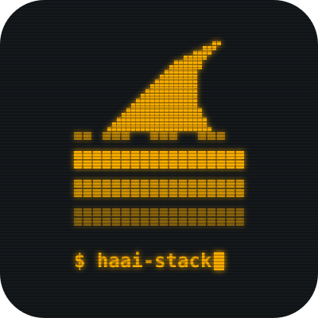

# haai-stack

**Harness-Anchored AI**

*Skills that build and maintain a good harness around your AI, so it works reliably and efficiently.*

---

## Goal

**HAAI-stack** (pronounced like *high stack* with a longer "ah") stands for **H**arness-**A**nchored **AI**. The skills in this repo help you build a harness around an AI agent, so the model can do its work efficiently and reliably.

The idea behind it is that an AI agent shouldn't have to reinvent the wheel for programmatic tasks that a CLI can already do. It shouldn't even need to know what the CLI does behind the scenes. Handing that work to CLIs makes the agent's output more deterministic, and it uses fewer tokens because the agent treats each CLI as a black box.

Because this ties the AI to tools that people built, HAAI can also stand for **H**umans **A**nd **AI**: a good harness is how people and AI work well together.
